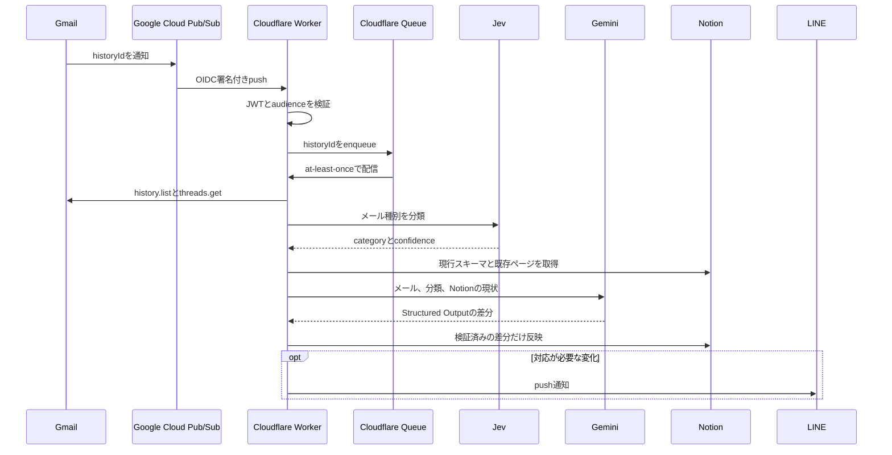

賃貸物件を探し始めると、同じ日に何通ものメールが届きます。

問い合わせ受付、空室回答、来店予約、日程変更、おすすめ物件。
返信元の仲介業者もスレッドもばらばらです。

最初はNotionへ手で転記していました。
ところが、表を整えるほど更新が面倒になり、「どの業者へ返事をしていないか」がNotionよりGmailのほうに残るようになりました。

そこで、Gmailへ物件メールが届くと、内容を分類してNotionへ差分反映し、対応が必要な変化だけLINEへ通知する仕組みを作りました。

<!-- TODO: スマートフォンで見たNotionの候補一覧を撮影する。物件名、担当者名、メールアドレスはマスクし、要返信と状況が同時に見える状態にする。保存先: /images/gmail-notion-line-property-hunt/notion-mobile.png -->

## 作ったもの

この仕組みで自動化したのは、メールの要約ではありません。
メールを受け取った後の状態遷移です。

- 新しい問い合わせをNotionへ追加する
- 空室、申込あり、募集終了を更新する
- 来店と内見の候補日時、確定、変更を反映する
- 具体的な回答が必要なメールだけ「要返信」にする
- 空室判明、募集終了、予約変更などをLINEへ通知する
- 自動処理から漏れたメールをChatGPTのScheduled Taskで回収する

通知を増やすと、今度は通知を読まなくなります。
そのため、「新しいメール」ではなく「判断が変わったとき」だけLINEへ送るようにしました。

<!-- TODO: LINEに届いた「空室あり」と「要返信」の通知を一枚にまとめて撮影する。個人名と物件住所はマスクする。保存先: /images/gmail-notion-line-property-hunt/line-notifications.png -->

## メール本文をWebhookへ流さない構成

Gmail APIのpush通知は、新着メールの本文をそのまま送る仕組みではありません。
`users.watch`で監視を登録すると、Google Cloud Pub/Subへ`historyId`が届きます。
受信側は、そのIDを起点に`history.list`を呼び、変更されたメッセージを取得します。

この性質に合わせ、Webhookではメールを処理しないことにしました。



Pub/Subから受け取るHTTPリクエストは、Googleが発行したJWTのissuer、audience、service accountを照合します。
検証後は`historyId`だけをCloudflare Queueへ入れ、すぐに`204`を返します。

QueueのconsumerがGmail APIから最新メッセージを取得するため、メール本文をD1へ保存する必要もありません。
D1に残すのはGmailのcursor、メッセージID、処理済みステップ、エラーだけです。

Gmailのpush通知と`users.watch`の更新方法は、[Gmail APIの公式ドキュメント](https://developers.google.com/workspace/gmail/api/guides/push)にまとまっています。

## 分類と情報抽出を二段に分ける

一つのプロンプトへすべてのメールを渡す構成も試せます。
しかし、物件のおすすめメールと予約変更メールでは、必要な出力も間違えたときの影響も異なります。

最初の段では、TypeSafeのJevでメールを次のカテゴリへ分類します。

1. 新着またはおすすめ物件
2. 問い合わせ直後の受付確認
3. 物件に対する仲介業者の回答
4. 来店または内見予約
5. 物件探しと無関係
6. 判定不能

分類に使うのは件名、送信者、宛先、本文です。
confidenceが閾値を下回ったメールは、無理に後続処理へ流さず「判定不能」としてNotionとLINEへ送ります。

二段目のGeminiには、分類ごとに異なる指示を渡します。
問い合わせ受付なら新規案件の識別、仲介業者の回答なら募集状況と要返信、予約メールなら日時の確定状態を重点的に抽出します。

出力はJSON Schemaで制約します。

```json
{
  "notion_action": "update",
  "property_updates": [
    {
      "name": "要返信",
      "type": "checkbox",
      "value_boolean": true,
      "value_string": null
    },
    {
      "name": "状況",
      "type": "select",
      "value_boolean": null,
      "value_string": "募集中"
    }
  ],
  "notification_event": "reply_required",
  "line_message": "空室あり。希望日時への回答が必要"
}
```

自然言語から直接Notion APIを呼ばせるのではなく、Workerが検証できる中間表現を返させています。
GeminiのStructured Outputについては、[Google AI for Developersの公式ドキュメント](https://ai.google.dev/gemini-api/docs/structured-output)を参照しました。

## Notionの列をプロンプトへ固定しない

当初は、Workerが「状況」「要返信」「予約日時」といった列名を知っていました。
この実装なら、JSONをNotion APIのpropertiesへ変換するだけで済みます。

実際に使い始めると、Notionの見せ方は変わります。
列を並べ替えるだけなら影響しませんが、名前や型を変更するとWorker側のマッピングが壊れます。
物件探しの途中で管理画面を改善するたび、同期処理まで修正するのは避けたいところでした。

現在は、メールを処理するたびにNotionから次の情報を取得します。

- データソースのプロパティ名と型
- selectの選択肢
- GmailスレッドIDに対応する既存ページ
- 既存プロパティの値
- ページ本文のブロック
- `last_edited_time`

Geminiへは、メールと分類別プロンプトに加えて、このNotionの現状を渡します。
Geminiが返すのは新しいページ全体ではなく、変更するプロパティだけです。

| 方式 | Notion変更への耐性 | 既存情報の保護 | API更新量 |
| --- | --- | --- | --- |
| 列名をWorkerへ固定 | 低い | 高い | 少ない |
| AIにページ全体を再生成させる | 高そうに見える | 低い | 多い |
| 現行スキーマから差分を生成 | 高い | 高い | 少ない |

Workerは、返ってきたプロパティ名と型が現行スキーマに存在するかを確認します。
selectなら値が現行の選択肢に含まれるかも確認します。
存在しない列や選択肢をGeminiが返した場合、その更新は適用しません。

さらに、Geminiの判定後にページを再取得し、`last_edited_time`が変わっていれば処理を失敗させます。
Queueの再試行では最新のNotionを読み直すため、AIの判定中に行った手動編集を古い差分で上書きしにくくなります。

Notionのデータソース取得とqueryには、[Notion APIのData source API](https://developers.notion.com/reference/query-a-data-source)を使っています。

## at-least-onceを処理ステップへ分解する

Cloudflare Queuesはat-least-once deliveryです。
同じメッセージが再配信される可能性を、consumer側で扱う必要があります。

D1の`mail_events`には、メールごとに次の状態を保存します。

```sql
CREATE TABLE mail_events (
  message_id TEXT PRIMARY KEY,
  thread_id TEXT NOT NULL,
  category TEXT,
  decision_json TEXT,
  notion_done INTEGER NOT NULL DEFAULT 0,
  line_done INTEGER NOT NULL DEFAULT 0,
  completed_at TEXT,
  last_error TEXT,
  updated_at TEXT NOT NULL
);
```

Notion更新後にLINE通知だけ失敗した場合、再試行ではNotionをもう一度更新せず、LINEから再開できます。
LINE Messaging APIには、メッセージIDから決定的に生成したretry keyも送ります。

ただし、この実装を「exactly-once」とは呼べません。
同じイベントが完全に同時実行された場合の所有権取得は、D1上でまだatomicなleaseにしていないためです。
現在の状態管理は通常の再配信には対応しますが、厳密な多重実行対策としてはprocessing leaseを追加する余地があります。

Cloudflare Queuesの配信保証も、[公式ドキュメント](https://developers.cloudflare.com/queues/reference/delivery-guarantees/)ではat-least-onceと説明されています。

## Scheduled Taskを障害回収に使う

Webhookから始まる経路だけでは、認証切れ、外部API障害、実装上の判定漏れをゼロにはできません。
一方、ChatGPTのScheduled Taskだけで即時通知まで担わせると、接続アプリと通知先の制約を受けます。

そこで、役割を次のように分けました。

| 実行経路 | 役割 | 実行タイミング |
| --- | --- | --- |
| Cloudflare Worker | 通常の差分同期とLINE通知 | Gmail受信時 |
| ChatGPT Scheduled Task | GmailとNotionの不整合修復 | 定期実行 |

Scheduled Taskは、接続済みのGmailとNotionだけを使います。
直近の物件メールとNotion全行を照合し、スレッドIDが存在しない、Gmailのほうが新しい、状況や予約日時が矛盾している場合だけスレッド全体を読みます。

修復対象がなければ通知しません。
修復した場合や人間の判断が必要な場合は、ChatGPTのScheduledに結果を残します。

この経路はWorkerの代わりではありません。
即時性はWorkerへ任せ、Scheduled Taskは異なる実装と認証経路から整合性を確認します。
同じ処理を二重に動かすのではなく、通常処理と照合作業を分けています。

## 運用前に詰まったところ

実装より設定に時間がかかった箇所もありました。

### Gmail watchには有効期限がある

`users.watch`は一度登録すれば終わりではありません。
現在はCloudflare WorkersのCron Triggerから毎日更新し、返されたexpirationをD1へ保存しています。

### Pub/Subのpush認証には二つの権限が関わる

push用service accountを作るだけでは足りませんでした。
Pub/Sub service agentが、そのservice accountのOIDC tokenを作成できるようにする必要があります。

### メール本文をログへ出さない

物件メールには氏名、電話番号、希望日時が含まれることがあります。
QueueとD1には本文を保存せず、例外ログも外部APIのレスポンスを短く切っています。
Gmail OAuthのscopeも読み取り専用です。

## 通知用LINEから生まれた入力経路

メール同期が動き始めると、空室や要返信の連絡がLINE公式アカウントへ届くようになりました。
通知を受け取るために作ったトーク画面ですが、当然こちらからもメッセージを送れます。

HOME'SやSUUMOで見つけた物件を、この画面へ共有できたら便利かもしれない。

この気づきから、公式LINEを物件候補の入力にも使うようにしました。
メール同期はこの機能がなくても完結しており、後から追加した別の経路です。

HOME'SまたはSUUMOのアプリで共有を押し、公式LINEへ物件URLを送ります。
WorkerはLINE Webhookの署名を検証し、次の順で処理します。

1. 送信者が自分のLINE user IDか確認する
2. 対応ドメインのURLを抽出して正規化する
3. Notionの物件URLとD1の処理履歴を調べる
4. Notionに保存した希望条件を取得する
5. GeminiのURL Contextで物件ページを読む
6. 必須条件への明確な不一致がなければNotionへ追加する
7. 追加、重複、条件不一致の結果をLINEへ返す

URLだけでなく、物件名、賃料、駅徒歩、面積からfingerprintも作ります。
別の計測用URLで同じ物件が共有された場合でも、重複を見つけやすくするためです。

物件ページに書かれていない条件を、モデルに推測させることはしません。
たとえばRC造でも戸境壁の構造までは分からないため、「内見時確認」として残します。

この処理では、希望条件を書いたNotionページもIntegrationへ共有する必要があります。
データベースが読めても、別ページが自動的に読めるわけではありません。

<!-- TODO: HOME'SまたはSUUMOからLINEへ共有し、「追加した」と返信される一連の画面を撮影する。物件名とURLの識別子はマスクする。保存先: /images/gmail-notion-line-property-hunt/line-share-flow.png -->

## この構成が向く範囲

この仕組みは、同じ種類のメールが継続的に届き、一覧の状態と通知の両方を保ちたい用途に向いています。
採用候補者との日程調整、問い合わせ管理、予約受付にも構造は流用できます。

一方、メール量が少なければ手作業のほうが単純です。
また、モデルが出した差分を検証するコードと、判定不能時に人間へ戻す経路は省けません。
自然言語を扱えることと、安全に更新できることは別の問題だからです。

物件探しでは、返信すべきメールが一通埋もれるだけで候補が消えることがあります。
Notionをきれいに保つことより、「返していない連絡が残っている」と知らせるほうが役に立ちました。

今もNotionの表は何度か作り直しています。
それでも同期処理を直さずに済むか。
次に確かめたいのは、そこです。
